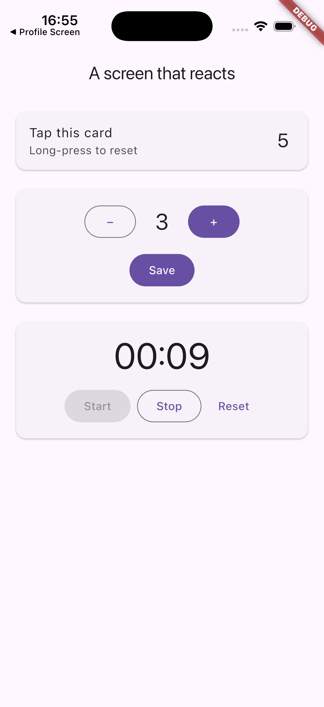
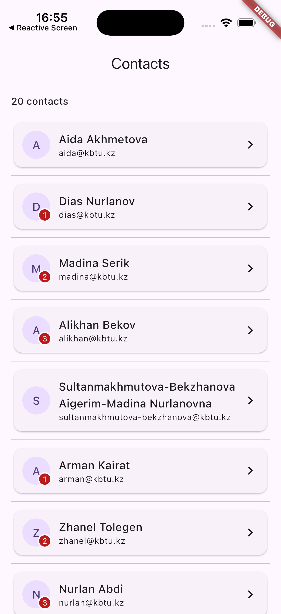
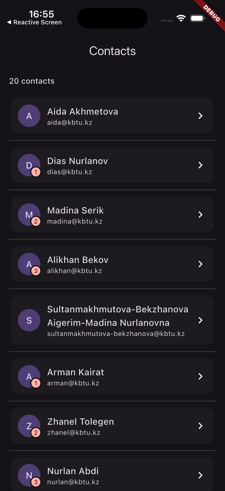
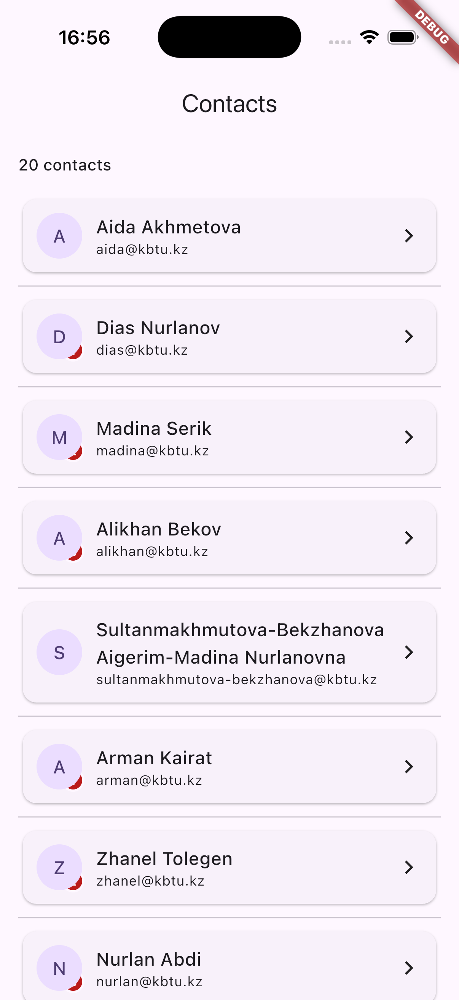

# flutter-2026-ulykbek

Mobile Development (Flutter) — Булганхан Ұлықбек, 4th year, Thursday 15:00–16:00.

| Practice | Folder | Topic | Run |
|---|---|---|---|
| 2 | [practice_02](practice_02) | Dart domain modeling — library catalogue | `cd practice_02 && dart run lib/week02/main.dart` |
| 3 | [practice_03](practice_03) | Your own widgets — profile screen | `cd practice_03 && flutter run` |
| 4 | [practice_04](practice_04) | A screen that reacts — state | `cd practice_04 && flutter run` |
| 5 | [practice_05](practice_05) | A screen that never overflows — layout | `cd practice_05 && flutter run` |

Every project passes `dart analyze` / `flutter analyze` with **No issues found!**, has been formatted with `dart format .`, and has widget tests (`flutter test`).

## Screenshots

| Practice 3 | Practice 4 | Practice 5 (light) | Practice 5 (dark) | Practice 5 (stack swapped) |
|---|---|---|---|---|
|  |  |  |  |  |
