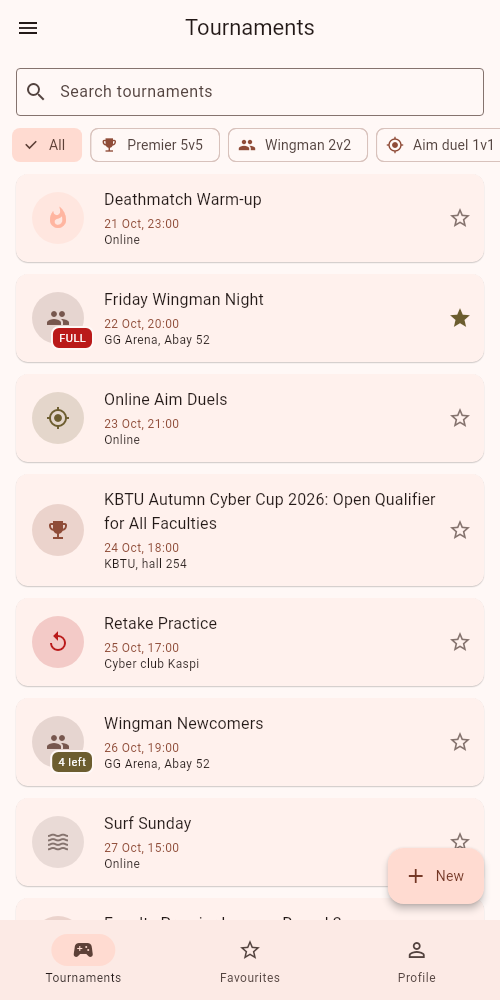
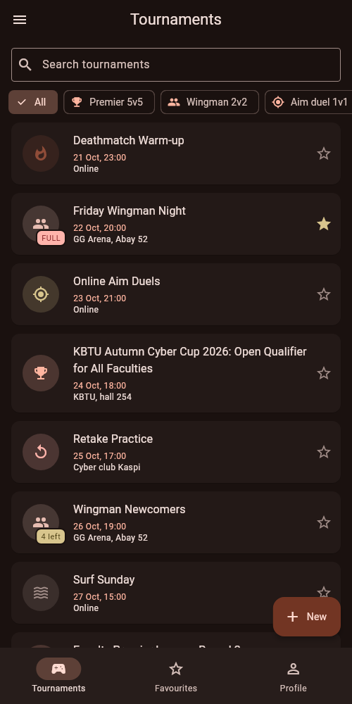
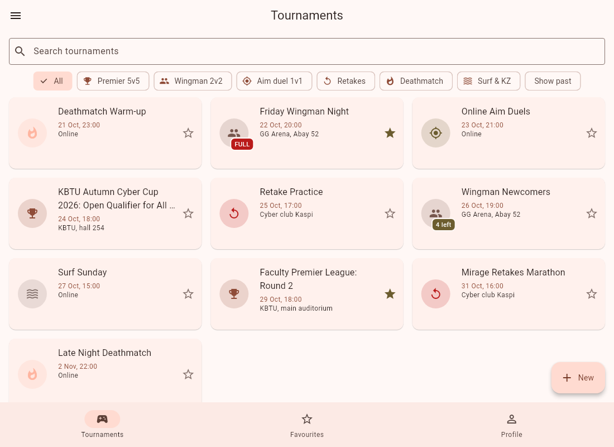

# CS2 Cups — Lab 1

Student **Counter-Strike 2 tournaments**: each cup has a format (Premier 5v5, Wingman 2v2, Aim duel 1v1, Retakes, Deathmatch, Surf & KZ), a start time, a number of slots and a list of players. You set a nickname in Profile and **Join** a cup until it is full. Online cups have a Discord / FACEIT link instead of a venue. All data lives in memory.

```bash
flutter run -d chrome
```

| Phone · light | Phone · dark | Tablet · grid |
|---|---|---|
|  |  |  |

## Structure
```
lib/
  main.dart               theme mode, routes, onGenerateRoute, onUnknownRoute
  routes.dart             Routes constants + DetailArgs / FormArgs
  models/                 Category (enum), Tournament, Profile, Countdown (sealed)
  data/seed.dart          twelve tournaments relative to today
  utils/format.dart       18 Oct, 10:00 — no packages
  screens/                shell, list / favourites / profile tabs, detail, form
  widgets/                TournamentCard, CategoryAvatar, EmptyState
```

## Decisions
The list of tournaments and the profile live in the shell's State, because all three tabs and the detail screen read them; tabs get them through constructors and send changes back up as callbacks. The detail screen takes callbacks rather than returning a value, because it changes the item several times while it is open (join, leave, edit) and the list must follow each change, while the form returns one finished Tournament through `pop`, so `await pushNamed<Tournament>` is the natural shape. The grid is chosen by `LayoutBuilder`, not `MediaQuery`, because what matters is the width the tab actually gets, not the size of the whole screen. The form's `PopScope` compares a snapshot of every field taken in `initState` with the current values, so it only asks "Discard changes?" when something really changed, and `Save` never asks because it pops from code. The theme mode lives in `MyApp` above `MaterialApp`; since the route caches the shell, the shell mirrors the mode it shows in Profile. With week 9's tools I would move the tournaments and profile into a `ChangeNotifier` with Provider, so the detail screen could read the live item instead of keeping its own copy and passing callbacks around.
